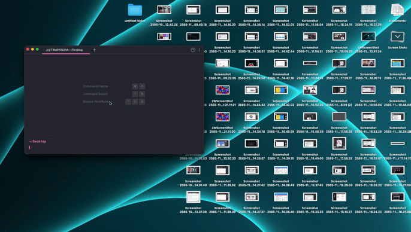
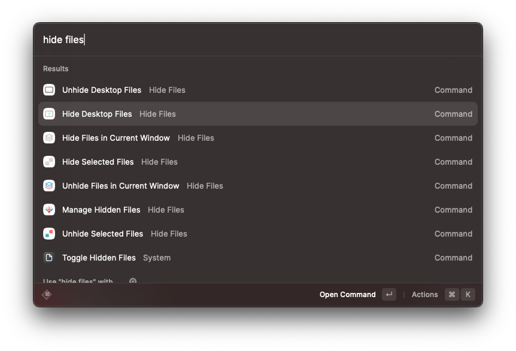

# hide-files

Hide (and show again) every file and folder on your macOS Desktop with a single command.

## Motivation

While participants were setting up their presentations for the SCB TechX Hackathon pitches, I noticed that many of their desktops were cluttered with screenshots, folders, and other files that had nothing to do with their presentations. How might we give people a single command to hide their desktop icons, without having to remember or look up an obscure terminal command?

## Demo



⚠️ This CLI works only on macOS.

## Installation

Install the CLI globally (requires Node.js 18 or later):

```bash
# npm
$ npm install -g hide-files

# yarn
$ yarn global add hide-files

# pnpm
$ pnpm add -g hide-files
```

## Usage

Hide the clutter on your Desktop 🤫

```bash
$ hide-files hide
```

Show all files and folders on your Desktop again

```bash
$ hide-files unhide
```

`hide-files` sets the macOS `hidden` flag on each item with `chflags`. It skips dotfiles (such as `.DS_Store`), and nothing is moved or deleted. Note that `unhide` shows every item on your Desktop, including any you had hidden yourself before running `hide`.

## Development

```bash
$ pnpm install
$ pnpm test     # run the unit tests
$ pnpm lint     # check lint and formatting (pnpm lint:fix to fix)
$ pnpm build    # compile TypeScript to JavaScript
```

## Special Thanks 🙏



This project is inspired by [Raycast](https://www.raycast.com/)'s [Hide Files extension](https://github.com/raycast/extensions/tree/main/extensions/hide-files), which is fully open source.
